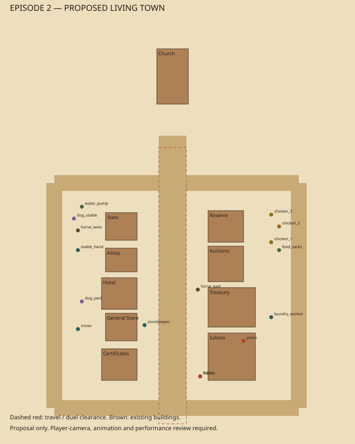

# Living GoldMine town — preparation contract

Founder request, 2026-10-15: Episode 2's town needs visible doors/windows, people, horses, dogs and chickens in the background, more avenues and purposeful use of empty space. The follow-up asks for the necessary skills/scripts. This deliverable is that toolkit; it does not claim new playable town art.

Entry points: `.claude/skills/ep2-living-town/SKILL.md` (Claude/shared workflow) and `.agents/skills/smokerealm-living-town/SKILL.md` (Codex route). Four component skills cover streets, facades, background life and proof. Run `tools/ep2_town/README.md` commands to create fresh audit/plan/handoff artifacts under `work/`.

The generated [example plan](example/town-plan.json), [asset jobs](example/asset-jobs.json), [capture jobs](example/capture-jobs.json) and [marker scene](example/proposal-markers.tscn) make the handoff reviewable. Regenerate against the current source before production.

## Current source facts

The shared town builder defines ten buildings on two sides of one main street, with the church at its end. The Blender generator already defines sash windows and doors. Their actual first-person visibility was not reviewed in this preparation pass. The woods arrival and town room build the same set at the same world coordinates. The latest Sheriff/Minister cast supersedes cancelled JakeX. Keep all existing plot, armory, three-heart, first-person, access and nonthreaded export contracts.

## Starter creative proposal

| Place | Activity and purpose |
|---|---|
| Main street | arrival, certificate/saloon travel and duel remain clear; porch activity at edges |
| North/south cross streets + west/east avenues | connected circuit around existing blocks, sightlines and services rather than one empty strip |
| Stable yard / hitch rails | two horses shifting/drinking; stable hand brushing/feeding; pump and bucket marks |
| General-store porch / assay yard | sweeping shopkeeper, ore-sack worker, worn service paths |
| Hotel service yard | laundry worker and a line of period linen |
| Feed yard | three chickens scratching/pecking, feed sacks, future coop dressing |
| Assay/stable shade | two dogs sniffing/resting with varied pauses |
| Saloon porch/interior | fiddler with genuine bow contact, reuse kit piano; quiet spatial sound that yields to every story beat |

The generated plan includes five roads, ten facade targets, twelve ambient people/animals, two instruments, two props and seven capture jobs. Proposed caps: 24 ambient actors and two instrument emitters; actual performance is unmeasured. Models/clip/rights bindings stay unresolved. Piano music alone does not prove a visible pianist. Stable/feed/laundry support props described in the skills still require authoring/job additions.

## Handoff acceptance

The scripts validate declaration/geometry, not rendering or engine navigation. Road connectivity uses axis-aligned centreline junctions; collision tests use conservative ground rectangles/circles and static placements. Moving actor-to-actor avoidance, height/slope, terrain scrub, meshes, doors/windows visible from the eye camera, animation/contacts, audio mix and GPU/pack size need actual production evidence.

Any runtime implementation must update the shared builder once for both users, widen desert exclusion for side streets, author real loops driven by the chamber step clock, preserve Bull's timed exit/return and protect the witness/duel lane. Use existing town/native/arc, capture, reference-match, real Godot export and browser gates. Keep preparation status distinct from tested runtime and confirmed deployment.
