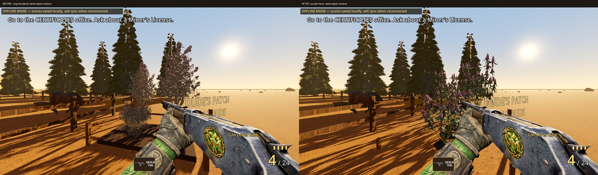
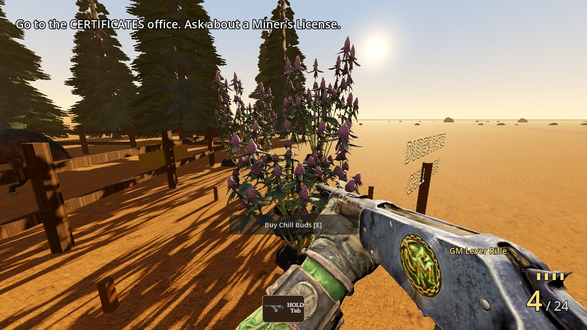
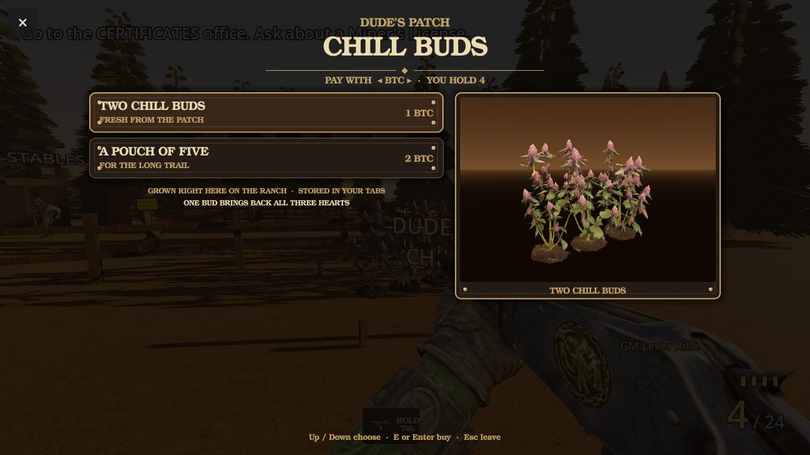
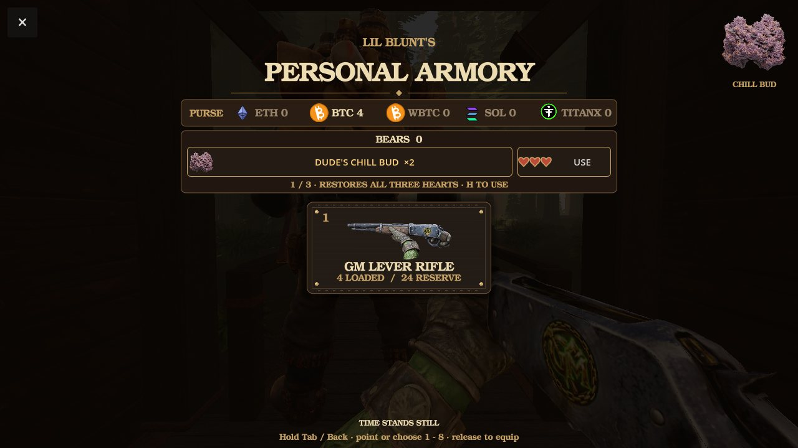
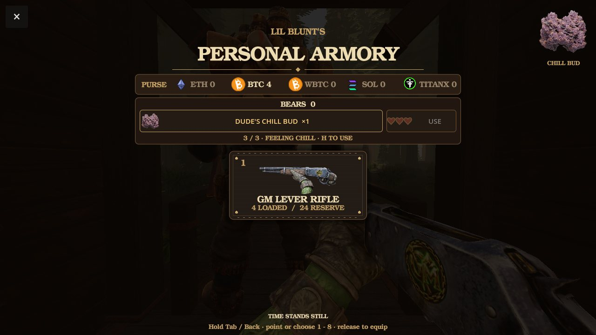

# Dude's purple-haze plants and actual healing bud — 2026-11-07

## Result

Replace the fragment-like bed foliage with a textured, rooted three-plant grove from the founder's original purple-haze reference. The same accepted generation supplies the shop's smaller Frost showcase and taller growth behind the bed. One grove is placed in the bed: the source already contains three plants. The tree variants stand farther back to keep their larger roots out of the bed. A low, irregular textured earth mound replaces the box; short boundary stakes replace the crown-height rails.

Foliage uses instance-local materials, non-metallic rough surfaces, supplied normals and albedo-multiplied emission. The old additive white emission washed out the texture. The soil, stems, green leaf fans and purple flowers remain textured. This is a stylized game model, not a claim of photographic reference fidelity.

Tabs uses an actual transparent render of the supplied `Dude Buds.glb`, rather than its generic leaf symbol, with a larger view when selected. The preview is opposite the close button and does not replace weapon controls. The image streams with `Ep2Extras`; the existing icon holds its place only until that pack mounts. All original inventory, payment, full-three-heart healing, pause, save, keyboard and touch transactions are unchanged.

## Provenance and spend

- Brief: https://drive.google.com/file/d/14UKze9iUyTJahWJp1vVIil6oh31xcHQ6/view
- Source folder: https://drive.google.com/drive/folders/1a0rtGR_dFvtDRQ3XJqEpPCS0vukqbkBe
- Plant reference: `Purple_haze_weed_on_stalk_cee4cf27_2K.jpg`, Drive `1mNQOYJcOCL2TYfsKn2qeXph6oFg-SIde`.
- Actual harvested bud: `Dude Buds.glb`, Drive `1fLs_htE5ds86DYrzXQUB-lnpaIUpT3t9`. Original is 342,726,024 bytes / 7,373,606 triangles, kept outside game resources; the icon is rendered directly from that original, not the unsuccessful simplification experiment.
- One Tripo image-to-model call, CLI alias `tripo-v3.1`, API value `v3.1-20260211`, face limit 15,000, textured PBR. Task `5fe79f47-5c7b-4753-8976-c390edbef6b8`: **30 credits billed**. Total **30**, remaining **5**, frozen **0**. No paid conversion, UV step, rigging or reroll. `generation.json` contains the sanitized receipt.
- The CLI submitted successfully before its default history directory failed to write. The task was recovered through `tripo usage` and resumed with `task watch`; it was never resubmitted. Subsequent CLI state is workspace-local.
- Preparation: `tools/ep2_blender/prepare_purple_haze.py`; standard GLB, retained UVs, 1024px albedo, 512px normal, 256px ORM. Nineteen tiny overlapping/coplanar faces removed from the source; six further contacts removed after reducing the Frost showcase. Grove and tall variants: **13,489 triangles** each; the Frost showcase is **11,864**, under its existing 12,500-triangle gate. Each has one material. Visible patch geometry changes from 82,867 to **40,467 triangles**.
- QA: pass, no same-facing coplanar overlap, floating parts, degenerate faces, inconsistent normals or non-manifold edges. One opposing-face contact in the taller variant is accepted on its folded, double-sided foliage; it is not same-facing flicker. Duplicate-position vertices remain deliberately at source UV/normal seams; the open leaf surfaces are intentional, double-sided foliage. Old extracted textures were removed only after finding no runtime references; Git retains the old source.
- Reproduce icon: `tools/ep2_blender/render_chill_bud_icon.py ORIGINAL.glb src/episode2/extras/patch/chill_bud.png` through Blender `-b -P ... --`.

## Verification

Local source and the corrected Frost were validated on the clean-clone import/export. Only Frost changed after the first clean export; its model and texture caches were removed before reimport/export. Every other runtime file matches the full-suite snapshot.

- The full native CI gate block completed; its only initial failure was Frost at 13,489 triangles exceeding the existing 12,500 gate. The corrected 11,864-triangle Frost passes the rerun of the entire armory-chain suite. Other full-suite results are retained, not relabeled as a clean initial run.
- Final healing transaction test: **14 checks / 0 failures**. Actual woods-host capture: **1 heart → 3**, exactly **one bud consumed**, panel stays paused. Capture asserts the actual streamed PNG is loaded.
- Final non-threaded web export: **0 script/parse errors**. Main **199,204,672 B** (24,768 B under gate); extras **194,574,016 B**, both under 190 MiB. Named and tracked extras presence gate passes, including the bud PNG. Texture probe: **71 models / 0 excluded-but-used textures**.
- Local Chromium WebGL: build `dev-local`, extras HTTP 200/ready, no script errors, production harness disabled, real keyboard input rejects an invalid access code. No unlock shortcut used.
- Founder front-page lock: **5 files unchanged**. Green-VFX check passes. Staged security sentinel: no high-severity blockers.
- Public deployment verification: pending.
- Not tested on a physical phone; not founder-verified.

## Player-view evidence

Same player position, look and Compatibility renderer before/after:

Portrait/landscape captures: `tabs-390x844.jpg`, `tabs-844x390.jpg`. `local-verification.json` records the source, sizes, asset and browser checks.
