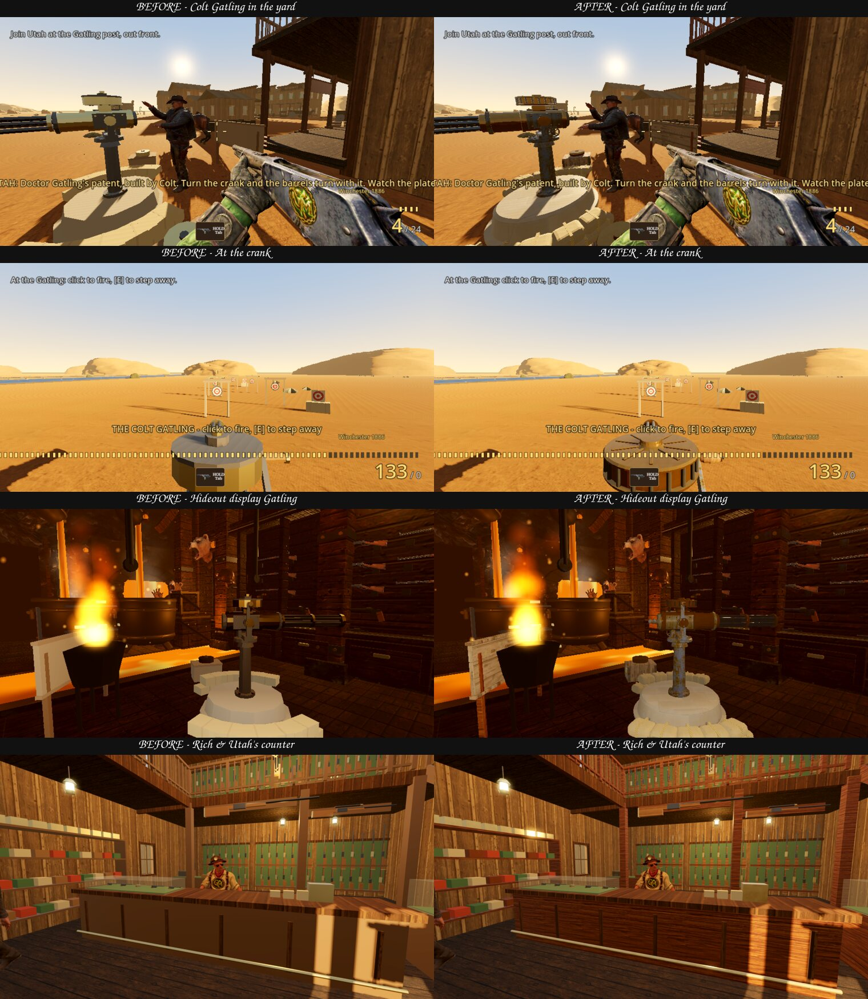
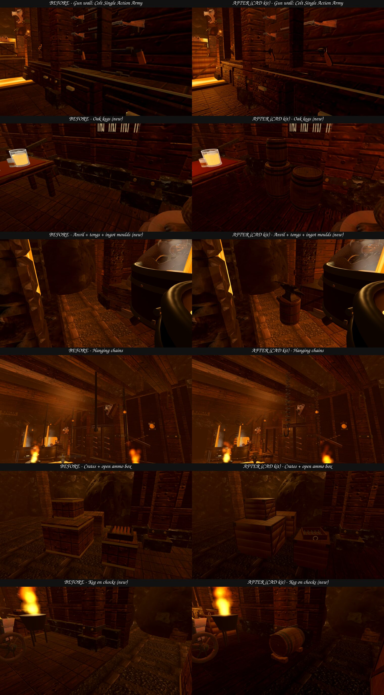
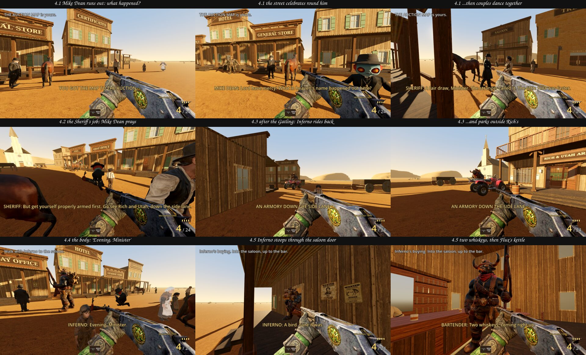
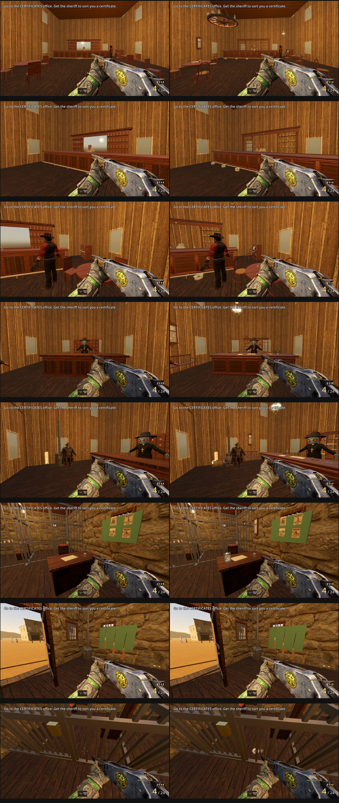

# CAD quality, seamless transitions, audio, draw rewrite — 2026-10-25

Source: Drive `PROMPT_EPISODE2_CAD_TRANSITIONS_DRAW_REWRITE_2026-10-25.md` (copied to the repo root) + Google Doc with the founder's
screenshot ([founder_elevator_screenshot.jpg](2026-10-25_cad_transitions/founder_elevator_screenshot.jpg)): "Remove Lil Blunt in the
elevator! This is ridiculous. How can he be in the elevator and in the other room holding his rifle". Baseline master `473ab49c`.

## P0 — Transitions

| Founder request | Measured cause | Repair | Proof |
|---|---|---|---|
| §1.1 "no arbitrary pause between the facility and the doorway" | The door let him through only after Inferno's whole EXIT show ended: `_walk_through_ok()` needed `_hold <= 0 and not _show_active`, so he stood at an invisible wall (z 15.0, the door at 16.4) for the "made it" line, 4.46 s + 0.2 s gap. | `SmeltingFacilityChamber._exit_open()`: across the lava and Inferno has STARTED "made it" (the frame after landing). The show's last step is now a non-blocking call, so Inferno leads at once (2.9 m/s). The hand-over carries `voice_left` (whatever line is still playing), and the lift's first line waits for it (`Ep2Interlude._begin_carry_line_after`). Nobody is cut off. | `tests/seamless_chain_test` 1.1: the door opens with >3 s of the line left. Walking from the bank, the cut comes within 0.6 s of a straight walk at 3.4 m/s. "made it" is still playing at the cut, and the lift's line is queued behind it. |
| §1.2 "Lil Blunt already inside the elevator" | The lift is pre-built behind the hideout and drawn in its open doorway (`ep2-open-door-portal`). Its third-person body was built at the room's origin, the middle of the cage, and stayed visible: first person hid it only once the room was *activated*. | `Ep2Interlude._hide_unentered_body()` at the end of every background build (after the warm views compiled its shaders) and in `MineLiftChamber.portal_begin()`. The body shows only in a director shot. | Same-camera real-render capture ([elevator_before_after.jpg](2026-10-25_cad_transitions/elevator_before_after.jpg), `tools/ep2_shots/door_portal_shot.tscn`, opengl3): master shows the green Lil Blunt in the cage, the fix shows an empty cage. Gate: seamless_chain 1.2. |
| §1.3 "long painful delay where nothing happens; scene rewinds" (elevator → forest) | **Root cause:** `Ep2SessionRoot._enter_chamber_chained` activated the pre-built lift, whose `setup()` immediately asked for the woods to be pre-built (a NEW `_pb_vp`). The root then freed `_pb_vp`, i.e. the new viewport with the woods inside it. At the lift's exit the woods were built synchronously (the freeze) and set up WITHOUT the hand-over, back at their own entrance `SPAWN` z=2 with Inferno's intro line again (the rewind). The older gates entered the lift without a pre-build, so they never hit this path. A second dead wait: the cage topped out at 22 s, but Inferno's plan speech runs ~32 s, so the cage sat shut at the top for ~10 s. | The pre-built room's viewport is held in a local and freed after activation, and the new pre-build survives. A finished pre-build stops rendering (`UPDATE_DISABLED`) instead of drawing a second world every frame. The lift climb lasts as long as the plan speech (`_plan_rise_seconds`, never < 22 s): the gate opens as Lil Blunt's reply starts (flagged from inside the reply, so the line is never skipped). The mouth stays open until Inferno is in. | `tests/seamless_chain_test` 1.3 on master FAILS 5 checks, including "where he stood, not back at the woods' own entrance: (0,0,2) vs mapped (0,0,5.95)". With the fix: ALL PASS. The woods build survives the cut, the cage reaches the top <0.3 s before the gate starts opening, all plan lines play in order, and walking out lands in THE pre-built woods at the mapped spot with no intro replay. |

## P0 — Audio

| Founder request | Measured cause | Repair | Proof |
|---|---|---|---|
| "People VO overshadowed by music" | Loudness (ffmpeg ebur128): town theme -16.2 LUFS, recorded town takes ~-20 LUFS played at 0 dB, so speech was 4 dB UNDER the music before any duck. Townspeople's passing greetings (3D, -2 dB, unit 5 m) never ducked the music at all (~6-10 dB under it). Story lines ducked to -16 dB, but a music fade-in tween (the forest → town crossfade) kept running and pulled the music back up over the words: master measured -7.6 dB 3.4 s into a line, rising to 0. | AudioManager: ONE tween owns the music level (`_tween_music_to`). Duck, restore and every fade-in kill the previous one, and fades aim at the current duck level. A line starting during the restore pulls it straight back down. Town takes +2.5 dB (the loudest take peaks at -2.8 dBTP, so they stay under -0.3 dBTP). Greetings: unity gain, unit size 8 m, heard to 18 m, and they duck the music to -10 dB for their length (`duck_for_speech`). | `tests/ep2_audio_mix_test` ALL PASS. Crossfade probe: master -35.1 → -7.6 dB during a line, fixed -16.0 / -16.0 dB. `ep2_voice_duck_test` still ALL PASS. |
| "Train inaudible when it passes" | The train (`Ep2TownLife`) had no sound player at all, and no train recording ships in the repo. | `tools/ep2_audio/synth_train.py` synthesizes, license-clean and deterministic: a 12 s seamless steam run (5.5 chuffs/s for 7 m/s on 1.52 m drivers, rail-joint clacks of loco + 3 cars every 12 m, rumble, hiss) at -16.1 LUFS, and a three-chime whistle. They ride on the locomotive as 3D sound: unit 42 m (≈-2 dB at mid-street, 106 m), heard to 460 m, whistle on appearing and in front of the town, -7 dB under speech. Only the live room plays it, and a room pre-built off-screen is silent. Files in the streamed extras pack. | `tests/ep2_audio_mix_test` train block: plays when it appears, loops, whistles, dips under a line, silent off-screen. [Spectrogram](2026-10-25_cad_transitions/train_run_spectrogram.jpg) of two loops back to back: seam jump 0.0015 vs median sample step 0.019. |

## P1 — CAD pass, part 1 (Colt Gatling + photo-scanned surfaces)

- **Colt Gatling**: FreeCAD solids (`tools/ep2_cad/gatling_cad.py`, run `GATLING_CAD_OUT=<dir> freecadcmd tools/ep2_cad/gatling_cad.py`) assembled in
  Blender (`tools/ep2_blender/build_gatling_cad.py -- --cad <dir>`) into the same `gatling_post.glb` node tree (Gatling_Post -> Gat_Yaw -> Gat_Pitch ->
  Gat_Barrels / Gat_Crank, markers Gat_Muzzle / Gat_Eye / Gat_Eject / Gat_Sign). 44,120 triangles. Drum lowered so the gunner's line of sight clears it.
- **Period bronze** (`Ep2GatlingPost.BRONZE`, `DRESS_YARD` / `DRESS_INDOORS`): the shared kit Brass (0.72, 0.55, 0.25) read pale cream in the sun.
- **Ep2Pbr** (`src/episode2/art/ep2_pbr.gd`): 13 CC0 sets prepared by `tools/ep2_pbr/prep_pbr.py`; object-space triplanar; the set's own mean albedo
  is divided out so each surface keeps its authored average colour; metal capped for the Compatibility renderer. Import presets are tracked
  (lossy WebP 0.85 + mipmaps; CI's default would be lossless, several times the download).
- Measured (luma mean / local detail, same cameras): Armory counter 161.9 / 2.98 -> 159.7 / 3.48; gallery 160.0 / 2.61 -> 158.2 / 3.06; town
  fronts and the smelter unchanged by this part (their props are the next parts).
- Gates: `tests/ep2_pbr_test` (new, CI) + armory guns / two-storey / gold town / personal armory / seamless chain pass. `ep2_hideout_corrections_test`
  (4 FAIL) and `ep2_smelting_facility_test` "Bull PBR" (1 FAIL) fail identically on master: pre-existing, not CI gates.

## P1 — CAD pass, part 2 (the smelter's prop kit)

- **FreeCAD kit** (`tools/ep2_cad/smelter_kit_cad.py` -> `tools/ep2_blender/build_smelter_kit.py` -> `src/episode2/extras/hideout/smelter_kit.glb`,
  52k triangles, streamed): a Colt Single Action Army (fluted cylinder with its chambers, ejector housing, case-hardened frame, hammer,
  trigger guard, plow-handle walnut grip with backstrap), oak kegs (staves with real seams, iron hoops, recessed heads, bungs), chocks, a
  London-pattern anvil on a banded stump, tongs, a pouring ladle, a three-bar ingot mould, a coal shovel, an octagonal sledge, a pick, oval
  chain links and a hook, a .45-70 round, a planked crate and an open ammunition box.
- **In the hideout** (`HideoutDressing`, `SmeltingFacilityChamber`): the six gun-wall revolvers, the eight hanging chains and the pour
  ladles' hangers, every crate and ammo box, the spilled rounds and the leaning shovel / sledge are the CAD pieces at the same spots; new
  kegs, a keg on chocks, the anvil with its tongs, two ingot moulds and a pick (each with a walk blocker).
- **Never a missing prop** (`Ep2KitProps`): the hideout is built a few seconds into the opening film, usually before the web build has the
  streamed pack; the old primitive stands in and is swapped to the CAD piece the moment the pack mounts (normally under the film).
- **Colour found and fixed**: the Blender kits write their colours as if sRGB but glTF stores them linear, so every kit colour shows a stop
  brighter in the engine (that brighter look is what the Armory and the yard Gatling have always shown, and they keep it). In the fire-lit
  hideout the kit pieces take their intended colours (`Ep2Pbr.dress(..., kit_tone)`), so the Colts are dark blued steel with walnut grips,
  not silver with ivory. The painted-iron set has no metal map: its metal now applies uniformly and its roughness is matte.
- Proof: `tools/ep2_shots/smelter_kit_shot.tscn` (`fallback=1` renders the old props from the same build). Gate: `tests/ep2_smelter_kit_test`
  (new, CI). Facility, interlude, seamless-chain, transition, PBR and armory-guns gates pass.

## P1 — Section 4: the post-draw rewrite

The town's beats are now STREET, OFFICE, TO_BAR, BAR, SQUARE_UP, DRAW, **WON, JOB, TIP, ARMORY, BULL_BACK, BODY, DRINKS**, JAIL_TIP, JAIL,
GEARED, DONE (`src/episode2/chamber/gold_town.gd`). Fort Knox is never opened.
- **4.1 WON**: Inferno does **not** come. Minister Mike Dean, now **rigged** (`tools/ep2_motion/rig_scan_character.py` on the founder's
  model, `src/episode2/extras/people/minister_mike_dean.glb`), **runs** out from behind his counter (CMU 16_35) and asks what happened;
  the Sheriff answers. The street **celebrates** round Lil Blunt (CMU 79_69 cheer / 80_43 clap) and then **couples dance together** (the
  two partners of one CMU salsa take, 60_01 / 61_01, started on the same frame, at arm's length) - `Ep2TownPeople.celebrate()`. The
  clips were retargeted onto each townsperson's own rig and appended to their GLBs without touching a mesh or texture byte
  (`tools/ep2_motion/append_glb_clips.py`, verified: every original byte, clip, node and material identical). Mike Dean then kneels and
  **prays** by the stranger (CMU 23_03 + hands joined by `tools/ep2_motion/pray_arms.py`).
- **4.2 JOB**: the Sheriff, impressed with the shooting, offers the job - find out who let the bears hold Fort Knox, his prisoner knows
  more - and sends him to Rich and Utah first.
- **4.3 ARMORY -> BULL_BACK**: Lil Blunt can test the Colt Gatling; once he has fired it and stepped off, Inferno rides back in on his
  flame quad (`Ep2TownQuad`, the woods ride's model and seat) up the lane, townspeople stepping aside, and parks outside Rich's (clear of
  the Gatling yard; solid). "First whiskey's on me."
- **4.4 BODY**: the man Lil Blunt shot lies where he fell, Mike Dean praying by him. Inferno greets the Minister and asks who put a hole
  in his head; Lil Blunt: *"Must've been a bird that had to get rid of the heavy load."*
- **4.5 DRINKS**: into the saloon - Inferno (2.9 m) **stoops** through the 2.5 m batwing door (`Ep2DuckModifier`, a SkeletonModifier3D) -
  two whiskeys on the bar; his cousin **Flux** needs help with his new kettle; they part a while and will meet up later. Then the
  Sheriff's prisoner (the jailhouse, now downstream of the bar), then the river.
- Buying the long rifle + river gear on the first visit no longer ends the town early; after the jail he is either geared (on to the
  river) or sent back to Rich's counter for it.
- Lines are timed captions (no voice key on this box), with the speaker; a recording added to Ep2TownVoiceBank under the same speaker
  and text plays automatically.
- Proof: `tools/ep2_shots/post_draw_shot.tscn` (real renderer). Gate: `tests/ep2_gold_town_test` walks the whole sequence (CI);
  `ep2_fort_knox_arc_test` (beat list), town people / autonomy / audio / stable yard / Logan's Lake / interlude / armory gates pass.

## P1 — CAD pass, part 3 (the town's rooms furnished)

- **FreeCAD furniture kit** (`tools/ep2_cad/town_interior_cad.py` -> `tools/ep2_blender/build_town_interior_kit.py` ->
  `src/episode2/extras/town/town_furniture.glb`, 31 pieces, 92.7k triangles, 5.3 MB streamed; contact sheet `town_furniture_kit.jpg`).
- **Replaced where they stood** (same origin, footprint and heights - every seat, drinker's place, counter wall and story mark unchanged):
  the saloon's bar (raised panels, moulded top, brass foot rail on posts), back bar (turned columns, framed mirror, dentil cornice, forty
  labelled bottles, brass register, glass pyramids), tables (turned pedestal, cabriole feet), bentwood chairs (Thonet No. 14, cane seats,
  the balcony's too) and the upright piano (88 keys, sconces, sheet music); the office's counter (the open certificate book, bell, inkwell
  and pen, stamp), pigeonholes (rolled certificates in red tape, deed bundles, ledgers), pedestal desk (leather top, brass-pulled drawers)
  and pot-belly stove (mica windows aglow, nickel rail, the pipe elbowing into the wall).
- **New detail**: four cuspidors at the bar rail, a wagon-wheel chandelier on a chain and harp lamps hung where the rooms' warm lights
  already were, Vienna regulator clocks (pendulums swing: `Ep2Pendulum`), hall trees with hats, the piano stool, a poker spread and rounds
  of whiskey on the tables; the office's safe, waiting bench, captain's chair, desk lamp and split logs; the jail's lantern, keys, coffee
  pot, water bucket and dipper, the prisoner's supper in his cell, a broom.
- **Same tone as before** (measured on the real renderer, `tools/ep2_shots/interiors_shot.tscn`, master vs branch): office counter front
  61/22/2 vs 56/20/2, saloon bar 89/37/10 vs 82/34/8, the saloon frame average identical. Found on the way: since part 1 the whole town kit is
  PBR-dressed before `_furnish`, and the dressing is a surface override, so the saloon's old timber re-texture never showed - the CAD
  pieces take the same dark wood, with the walnut panels toned to the old fronts' brightness (`TOWN_TONE`).
- **Never in the way**: nothing new stands on a story mark, the Minister's panic run, a drinker's place or route, or a jail stand point;
  the new floor pieces (safe, bench, hall trees, chairs, wood box, piano stool, bucket) are solid; the floor detail stands on the boards
  (the rooms' floors are 0.06 / 0.05 above the street). While the web build downloads, the old pieces stand in and upgrade in place.
- Gate: `tests/ep2_town_furniture_test` (new, CI). Gold town, smelter kit and PBR gates pass. Rich & Utah's Armory - already the densest
  room, its routes tight - keeps part 1's photo-scanned detail for now.

## Not yet verified
- Web-build listening and a real-browser walk of hideout → lift → woods (headless gates + native GPU captures only). The founder's hard refresh is the acceptance.
- The synthesized train has not been listened to by a human. If it reads wrong, regenerate with ElevenLabs / VARCO when a key is on the box (same file names).
