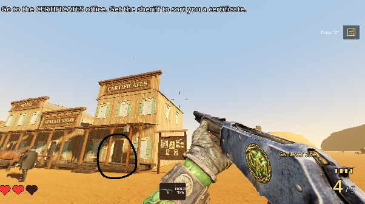
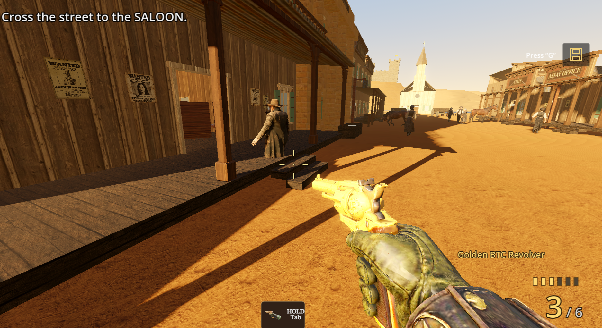
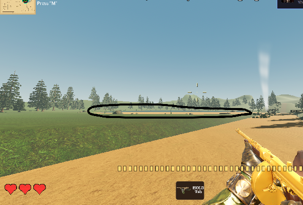

# Shipment and Bears (founder notes, 2026-11-04, verbatim)

  
I’ve told you many times that the contents of the certificates office need rto be fucking visible!!! This bug where Lil Blunt walks to the office to make things appear needs to be fixed. Create a skill for this.

  
I’m prove the way the sheriff stands on the actual platform so that their is coherence with the way he interacts with the world. The same goes for everyone else in the town. I’ve seen some women sitting in mid air. Make the characters in the world fit coherently

The lake still has the very same issue that I have asked to be fixxed 3 times already!!!! Why is there desert sand here!!! I told you that after Hammer’s men the land must slowly transition into lush greenery so that we can see that we are heading to waters. There’s mustn’t be desert sand by the edge of the water either!!!! This makes no sense!!!

Lets set up a rule that if you try to shoot Logan. He pulls out a golden revolver, The same Remington that Lil Blunt has that Rich sells and shoots you dead and you start all over from Dude on the horse. Also If the horse gets shot that must carry through so that Lil Blunt is unable to water it. Also the new section of the high ridge must literally continue from when Lil Blunt is walking forward up the ridge so that While Logan is behind him Lil Blunt proceeds forward and the stage continues from there moving in that direction. 

This also edifies the spatial convention already established in the game geographically as the river does pass by Rich and Utah which means that if one keeps on traveling in that direction and curves to the right they will eventually align and run parallel with the train as it currently lies. This means that the mapp must be adjusted slightly and reduce the sie of Lil Blunt’s logo on the map ever so slightly. Right now the stage inverts after pressing E which means that Lil Blunt is essentially moving in a different or the opposite direction. Also lets improve the design of the stage. I understand that its still new so we need to scaffold but now what’s really needed is more bears. The stakes are way too low. Some bears are archers remember so we need them to have that reach and lets also have some of hammer’s men on rafts to assist the bears. They are trying to drain the liquidity. Some of his men must even fire at Lil Blunt.

Now remember if they have shot Lil Blunt’s horse they should acknowledge that and not sayy “if you cant shoot the man shoot the horse anymore” Create a skill that lets you always gve characters in the the game intelligence to understand what changes may occur in their reality and can act accordingly so that they are not simply bots that dont know of it’s day or night.
