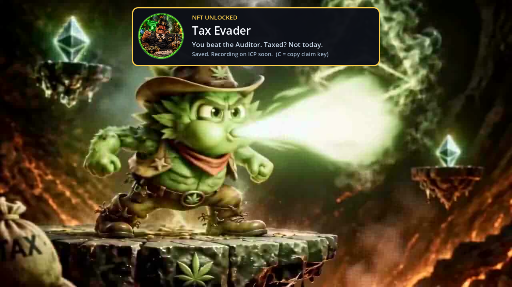
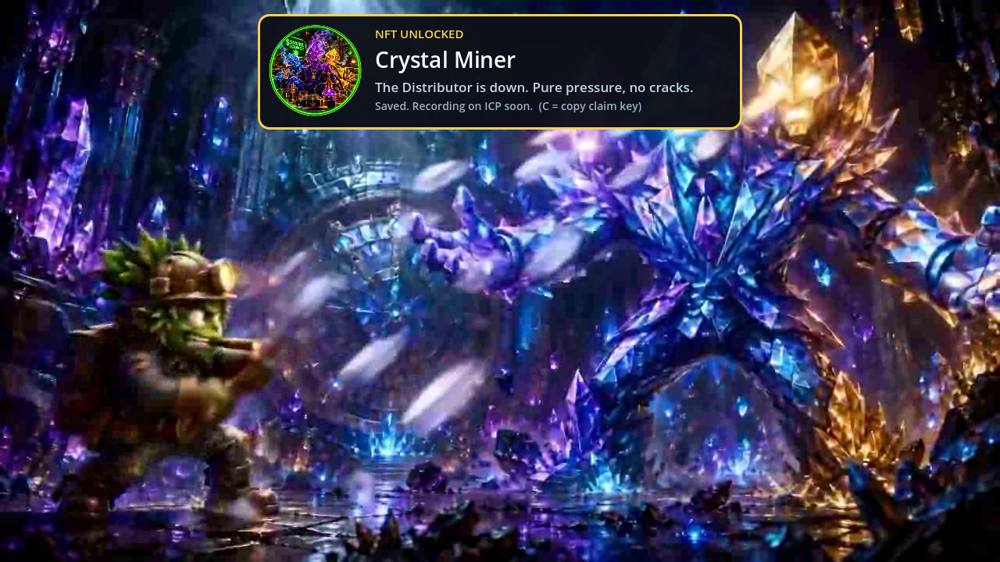
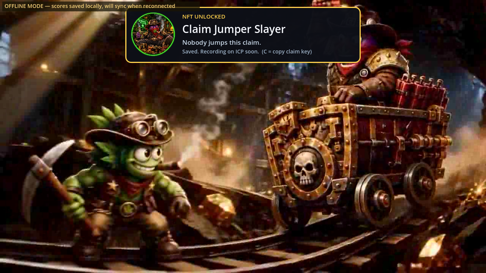

# Stage boss NFT reward restoration

Every real boss victory reaches NFT presentation even if its saved progression flag exists. Missing NFT records are issued; repeat clears present the existing card/jingle without duplicating issuance or overwriting ICP timestamps. Boss NFT speech remains removed; test reward speech is unchanged.

Checksum-verified Godot 4.3: all 53 NFT regression checks passed, with no script errors. Rendered and inspected all three missing-record/replay cards at 1280x720 with Compatibility; each reports voice=false. These are isolated reward UI captures, not complete campaign playthroughs. Security Sentinel, harness-hook checks and all five title locks pass.

Full source CI 40205025817, source 729f050ecdf406db8c786ad7c4abf86839237a2d, completed successfully, including gameplay/render/export/pack/security checks. Runtime files remain identical to this tested source. Owner explicitly authorized upload and release after checks pass. Production upload/public BUILD verification pending. Local public-browser probe encounters ERR_CERT_AUTHORITY_INVALID; TLS checks remain enabled.

## Real stage-completion verification

Loaded each authored stage through `SceneRouter.load_scene`, awaited `load_finished`, entered its real boss trigger and invoked the readied boss's actual `die()` handler. Captured the resulting ending sequence after the old delayed-speech window. All six combinations passed: stages 1/2/3 with saved boss progress but no NFT record, then the same stages with their prior real issuance loaded from isolated saves. Each reached LEVEL_COMPLETE, displayed its correct NFT card, and left NFT speech unloaded/silent. Replays preserved the full existing issuance record. Backend reporting and analytics were disabled only in the isolated native probe, and live NFT submission was disabled by offline mode. No production harness/unlock route was added.

Pinned editor: checksum-verified Godot 4.3; Compatibility renderer; 1280x720; desktop simulation; native source matching production source 9f9dfc78. The probe loads/finishes actual scenes but does not claim a manual full-campaign or real-phone playthrough. Founder playtest confirmation remains separate.

## Deployment and exact public export

Production run [40207231039](https://github.com/youngstunners88/GM-GAME/actions/runs/40207231039) passed every required gate and its butler deployment step. The actual log confirms the itch upload with 43.26 MiB fresh data. The later road-cart release preserves the NFT source files unchanged and passed run 40212082180. Public pack BUILD is `2026-10-25-0e3383d`, 198599104 bytes, below the 190 MiB gate; its compiled issuer contains the restored replay path. JavaScript, WASM and extras respond HTTP 200 with TLS verification enabled. The signed embed-load response initially returned a cached extracting status; a fresh read returned the complete public game frame.

The downloaded public pack itself was booted with checksum-verified Godot 4.3. Its actual compiled BUILD was asserted, and all six real SceneRouter → boss trigger → boss die → NFT card cases passed (three stages, missing record and replay). NFT voice remains unloaded/silent; replay records remain unchanged. The three screenshots above now show this exact public pack's rendered endings. The previous public pack reproduced the defect, providing a before/after regression check.

See `restoration-20261026/release-receipt.json` for source/build/run identities, public pack hash, HTTP checks, six exact-pack results and limitations. Browser-specific full-campaign, real-phone and new live-canister issuance are not claimed. Native exact-export checks and public delivery verification are complete; founder playtest confirmation remains separate.
